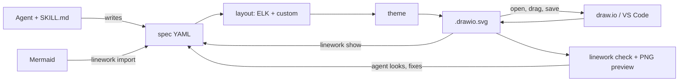

# Linework plan

## The problem

AI tools make diagrams in one of two ways. They write a text DSL like Mermaid or Graphviz, which renders in lots of places but looks generic and can't be nudged by hand. Or they write HTML/SVG with hardcoded coordinates, which can look good but turns into a dead end the moment you want to move one box.

What I want instead: the AI describes the diagram semantically, a real layout engine places it well, and a human can open the same file in a real editor and drag things around. Later the AI can change the diagram again without wiping out the manual work.

## Core decisions

1. **The AI never writes coordinates.** It writes a small semantic spec with nodes, kinds, groups, edges and labels. A layout engine handles placement. Models are bad at geometry and good at structure, so the work splits along that line.

2. **The file you embed is the file you edit.** Output is `.drawio.svg`. It's a normal SVG that browsers, GitHub and Markdown renderers display, and it carries the full draw.io model inside it. Open it in draw.io desktop, the VS Code Draw.io Integration extension or app.diagrams.net, edit, save, and the same file updates. No export step and no source file drifting away from the image.

3. **Semantics ride along inside the file.** Every shape stores its stable `id`, `kind`, `tech` and auto-layout position as draw.io custom properties. So `linework show` can turn any diagram back into the spec, including one a human edited. The AI edits YAML, never mxGraph XML.

4. **Quality lives in the tool, not the prompt.** Layout, theme, spacing and lint rules are deterministic code. A mid-tier model following the skill should produce the same quality diagram as a frontier model, because the model only decides what goes in the diagram.

5. **One CLI, several front doors.** `npx @itsthecsguy/linework` does all the work. The skill teaches agents to call it. An MCP server wraps it for chat apps with no shell. An AGENTS.md snippet covers agents without skill support.

## Why draw.io as the container

| Option | Hand editing in place | Markdown / HTML | Google Docs | Default look | Verdict |
|---|---|---|---|---|---|
| Mermaid | no | native on GitHub | image only | generic | accept as an input format |
| D2 | no | SVG export | image only | good with TALA, which is paid | no |
| Excalidraw | yes, `.excalidraw.svg` | yes | image only | whiteboard | possible second target later |
| tldraw | yes | needs its app | no | nice | SDK needs a license in production |
| draw.io | yes, `.drawio.svg` and `.drawio.png` | yes | add-on inserts and refreshes | dated unless styled | **pick this** |

draw.io's default look is stuck in 2012. That's a styling problem, and its style system is flexible enough to fix it: rounded corners, custom fonts, orthogonal edges with rounded bends, a `sketch=1` hand-drawn mode, and built-in AWS, GCP, Azure and Kubernetes icon libraries. It's Apache-2.0, so we can bundle the viewer and editor.

The ecosystem is the real reason. VS Code, Obsidian, Confluence and Google Workspace already have draw.io integrations, and we'd never match that by building our own editor.

## How it fits together



## The spec

```yaml
type: architecture        # architecture | flow | state | sequence | er
title: Checkout
direction: LR
groups:
  vpc: { label: Production VPC }
  data: { label: Data tier, in: vpc }
nodes:
  user:   { label: Shopper, kind: person }
  web:    { label: Web app, kind: client, tech: Next.js }
  api:    { label: Checkout API, kind: service, tech: Go, in: vpc }
  queue:  { label: order-events, kind: queue, tech: Kafka, in: vpc }
  db:     { label: Orders, kind: database, tech: Postgres, in: data }
  stripe: { label: Stripe, kind: external }
edges:
  - user -> web
  - web -> api: HTTPS
  - api -> db: SQL
  - api -.-> queue: OrderPlaced     # dashed = async
  - api -> stripe: charge
hints:
  - same-rank: [db, queue]
```

- Each diagram type has its own set of kinds, and each kind maps to a shape, icon and color in the theme.
- Groups nest. Use them for trust boundaries, VPCs, clusters and composite states.
- Edge shorthand is `a -> b: label`, `a <-> b`, `a -.-> b`.
- Layout hints are relational, like same rank, align or keep near. Never coordinates.
- We publish a JSON Schema so any harness can validate. Validation errors say how to fix the problem, because the model reads them.
- `linework import` accepts Mermaid flowchart, stateDiagram and sequenceDiagram, since every model already writes those fluently.

## CLI

```
linework build spec.yaml -o docs/arch.drawio.svg   # create, or merge into an existing file
linework show docs/arch.drawio.svg                  # print the spec; the AI edits this
linework check docs/arch.drawio.svg                 # lint layout and style
linework render docs/arch.drawio.svg -o preview.png # preview for agents that can see images
linework export docs/arch.drawio.svg --png --scale 2 --theme dark
linework import flow.mmd -o docs/flow.drawio.svg
linework edit docs/arch.drawio.svg                  # local draw.io in the browser, saves back
linework git-setup                                  # textconv so `git diff` shows spec changes
linework mcp                                        # stdio MCP server, same operations
```

`build` reads stdin too. Editing an existing diagram is `show`, change the YAML, `build` back into the same file.

## Keeping manual edits

This is the part that makes or breaks the tool.

- Each node stores the position the layout engine gave it. On merge, if the current position differs, a human moved it, so it becomes pinned.
- Same rule for edge waypoints, sizes and style overrides. Anything a human changed in draw.io is kept.
- New nodes are placed by incremental layout around pinned ones. ELK's interactive layering options keep the existing order. The fallback drops a new node into free space next to its neighbors.
- Removing a node from the spec removes it from the diagram. A shape someone added by hand in draw.io, with no metadata, gets its kind inferred from the shape, so a cylinder becomes a database, and an id derived from its label.
- Matching uses stable ids, never labels, so renaming a box keeps its position.
- `--relayout` drops all pins when you want a fresh layout.

## Making it look good

The theme:

- 8px grid. Node widths come from measured text plus padding, and nodes in the same rank share a width.
- Inter or the system UI font, 13px labels, a muted 11px line for `tech`.
- Neutral surfaces with one hue per kind family. Labels meet WCAG AA contrast. Light and dark variants.
- Groups get a light tint, a label in the top-left corner and 24px padding.
- Edges are 1.5px, orthogonal with rounded bends, small arrowheads, labels on a background halo. Async edges are dashed.
- Three themes to start: clean as the default, c4, and sketch.

Layout per diagram type:

- **Architecture and flow.** ELK layered with orthogonal routing, compound nodes for groups, and ports so edges leave from sensible sides.
- **Decisions in a flow.** Each branch leaves from its own point of the diamond, with its label right beside that point. Branches that join above a decision meet at one height. A diamond is only as tall as its text needs, so a decision is never the biggest thing in the flow.
- **State.** ELK layered plus start and end pseudo-states, self-loops, composite states as groups.
- **Sequence.** A custom layouter with lifelines as columns, messages as rows, activation bars, and alt/loop frames. ELK doesn't help here.
- **ER.** draw.io table shapes placed by ELK.

`linework check` fails on overlapping nodes, labels overflowing their shapes and edges running through nodes. It warns on more than 15 nodes, high crossing counts, unlabeled edges in flows and low contrast.

The skill tells the agent to loop: build, check, render a PNG, look at it, fix. Models that can see images catch things lint can't, like a lopsided layout or a label that reads wrong.

## The skill

```
skills/linework/
  SKILL.md              # when to use it, the loop, spec cheat sheet; under ~300 lines
  references/
    architecture.md  flow.md  state.md  sequence.md  er.md
    style-guide.md      # what makes a good design-doc diagram
  examples/             # spec + rendered pair for each type
```

The style guide is opinionated. One idea per diagram, around 12 nodes at most, every edge labeled with a protocol or verb, groups drawn along deployment or trust boundaries, request flow running left to right, and names matching the words used in the doc text.

Portability:

- SKILL.md follows the Agent Skills format that most coding agents now load, including Claude Code, Codex, Cursor and Gemini CLI.
- The only runtime requirement is Node, via `npx @itsthecsguy/linework`. Nothing in the skill depends on one vendor's tools.
- Harnesses with no shell use `linework mcp`. Its `render` tool returns a PNG so the model can still look at its work.
- Anything else gets a short AGENTS.md snippet that points at the CLI.

## Where diagrams end up

- **Markdown in a repo.** `` renders inline on GitHub and GitLab. Clicking the file in VS Code with the draw.io extension opens the editor. Obsidian has draw.io plugins too.
- **HTML.** ``, or inline the SVG. `linework export --strip` removes the embedded model when file size matters.
- **Google Docs.** This is the weak spot, and I'd rather say so now. Docs can't hold SVG and strips image metadata, so true in-place editing is impossible. The workable path is draw.io's Google Workspace add-on: it inserts a diagram stored in Drive and refreshes it after you edit. The fallback is `linework export --png --scale 2` with a link to the source. A later `linework publish --gdoc` could upload to Drive and swap the image through the Docs API.
- **Confluence** reads the same files through the draw.io app. **Notion and Slides** get PNG exports.

## Repo layout

Start with one TypeScript package. Split it later if the MCP server or renderer needs to ship separately.

```
src/spec      # zod schema, JSON Schema export, parser, Mermaid import
src/layout    # elkjs per diagram type, sequence layouter, incremental placement
src/drawio    # spec <-> mxGraph XML, read/write .drawio.svg and .drawio.png
src/theme     # tokens and per-kind styles
src/render    # headless rendering, PNG/SVG/PDF export
src/lint      # check rules
src/cli
src/mcp
skill/
evals/
```

Dependencies: elkjs, zod, a bundled draw.io viewer, and Playwright for rendering. Chromium downloads lazily, only the first time someone renders or exports.

## Phases

**0. Spikes.** Done except the Google Docs and VS Code checks, which need a human. Results and resulting plan changes are in [spikes/FINDINGS.md](spikes/FINDINGS.md). The original questions:
- Do our custom properties and stored positions survive a save in draw.io desktop, the VS Code extension and app.diagrams.net?
- Does the Google Docs add-on round-trip a `.drawio.svg` from Drive?
- Hand-build five reference diagrams in draw.io with a candidate theme. If they don't clearly beat Mermaid output, this plan changes.
- Rendering: draw.io's own engine in headless Chromium, or our own SVG writer? Pick one. A diagram that changes appearance the first time a human saves it feels broken.
- Look at existing draw.io MCP servers and generators for parts worth reusing.

**1. MVP.** Done. Architecture and flow types, ELK layout, the clean theme, `build`, `show`, `render`, and a first SKILL.md. Done when Claude Code and Codex each turn a design-doc prompt into a diagram that renders on GitHub and edits in VS Code.

**2. Round-trip.** Done. Merge keeps every existing position, places new nodes next to a neighbour, reroutes only new or stale edges with libavoid, and carries over notes. Hand-added shapes survive a stale spec. Also shipped: `tidy`, `--relayout`, and `git-setup` (textconv).

**3. Breadth.** Done. Sequence diagrams use draw.io's UML shapes, with activation bars inferred from call and reply pairs and frames that rebuild from vertical position. ER diagrams use crow's-foot notation. Mermaid import covers flowchart, state, sequence and ER. Icons cover AWS, GCP, Kubernetes and Azure from draw.io's bundled stencils. Themes: dark, sketch and C4. `build` also now slides colliding edge labels apart.

**4. Distribution.** Built and published to npm as `@itsthecsguy/linework`. GitHub Actions runs the tests on every push, and a version tag publishes the release (`npm run release`). `linework mcp` serves the same operations over MCP stdio (official v2 SDK), and `build_diagram` returns a PNG preview. A headless Claude with only those tools and no shell drew and then edited two diagrams with no lint errors. `linework edit` serves the bundled draw.io editor on 127.0.0.1 and writes saves through the embed protocol. A save after someone else changed the file goes to a side copy. Google Docs goes through Drive: `linework publish` copies files into the Google Drive for desktop folder at a fixed path for draw.io's Docs add-on, and `--pull` brings edits made from Docs back. `linework skill install` copies the skill. The tarball is 8 MB and installs and runs from a clean folder. Still unverified: the add-on round trip on a real Google account, and the VS Code extension.

**5. Look.** Built. Six styles: `clean` (new default: neutral boxes, hairline borders, groups as gray grounds, IBM Plex Sans), `soft`, `dark` (GitHub's dark colors), `sketch` (Kalam handwriting), `blueprint` (IBM Plex Mono) and `c4`. Color now follows rules: nodes stay neutral, error and success kinds keep red and green, `highlight: true` and `==>` draw the important path in the accent color, and `color:` marks categories. Boxes are sized from word-wrapped text measured in the bundled font, and each SVG embeds a subset of that font, so text fits wherever it renders. Edge labels sit mid-run on their edge, and `check` also flags labels on other edges or group borders. Sequence labels and guards move off lifelines.

## Evals

Run these from phase 1 on, not at the end.

- 30 prompts taken from real design docs, spread across the five types.
- Per run, measure whether the spec validated on the first try, lint results, crossing and overlap counts, and an LLM-judge score against reference images. Plus a human look at a sample.
- Round-trip test: build, apply scripted edits to the draw.io XML such as moving, restyling and adding a shape, then `show`, change the spec, `build`, and assert every manual edit survived.
- Run the suite on Claude, GPT, Gemini and one small local model. If quality drops sharply on the smaller models, logic is leaking into the prompt that belongs in the tool.

## Risks

- **draw.io drops our metadata on save.** Fallback is storing the spec in one root-level attribute and matching shapes by label and shape type. Spike 0 finds out.
- **The theme can't reach the quality bar inside draw.io's style system.** Then we need our own renderer and editor, which is a much bigger project. Spike 0 again.
- **foreignObject.** draw.io's HTML labels render through `<foreignObject>`, which non-browser renderers and some PDF pipelines can't draw. Prefer plain-text labels and export PNG for those targets.
- **Fonts.** Solved by embedding a subset of the bundled font in each SVG. Editors that rewrite the SVG (draw.io desktop, VS Code) drop it and fall back to system fonts until the next `linework build`; `linework edit` re-embeds on save.
- **A new spec format.** Models don't know it yet. Keep it tiny, publish the schema, put a cheat sheet in SKILL.md, and accept Mermaid.
- **Heavy dependency.** Chromium is big for an `npx` tool. Only download it when rendering is needed.

## Open questions

- Which editor do you reach for: the VS Code extension, draw.io desktop or the browser? That decides what we test hardest.
- For Google Docs, is "edit in draw.io, refresh in Docs" good enough, or is that a dealbreaker?
- Default look: decided. `clean`, minimal, with color only where it means something.
