<h1>
  <picture>
    <source media="(prefers-color-scheme: dark)" srcset="docs/brand/logo-dark.svg">
    
  </picture>
</h1>

Software diagrams your AI agent writes and you can edit by hand, in Claude Code, Codex, Cursor, Antigravity, Copilot, Grok Build or any other agent.

<picture>
  <source media="(prefers-color-scheme: dark)" srcset="docs/hero/hero-dark.png">
  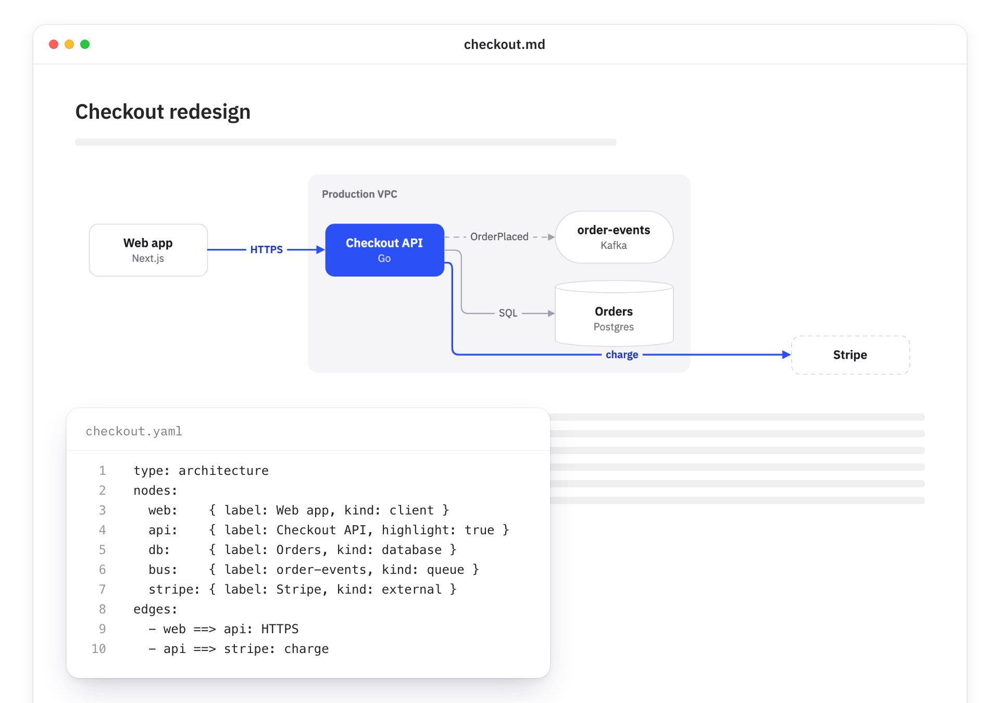
</picture>

Your agent writes a short YAML spec. Linework lays it out, styles it and writes a `.drawio.svg`. That file is an ordinary SVG that renders in Markdown, on GitHub and in HTML, and it carries the full draw.io model. Open it in draw.io, move things around, save, and the same file updates. The next time the agent changes the diagram, your edits stay.

## Quick start

### 1. Check what you need

- **Node 22.20 or newer** for the skills installer in step 2. Linework itself runs on Node 20+. Check with `node -v`.
- **Chrome, Edge or another Chromium browser.** Linework uses it in the background to measure text and draw. If you have neither, run `npx -y @itsthecsguy/linework install-browser`.
- **Using Codex?** Its sandbox stops Chrome from starting. Run `npx -y @itsthecsguy/linework install-browser` once, outside Codex. Linework's own headless Chromium does start inside the sandbox.

### 2. Give your agent the skill

```bash
npx skills add itsthecsguy/linework
```

The [skills](https://github.com/vercel-labs/skills) installer finds the agents on your machine, asks which ones to set up, and puts the skill where each one looks. It covers Claude Code, Codex, Cursor, Antigravity, Gemini CLI, GitHub Copilot, Grok Build, OpenCode, Windsurf and about 70 more.

It installs for the current project by default. Add `-g` to install it for every project. To skip the prompts, name the agents:

```bash
npx skills add itsthecsguy/linework -g -a claude-code -a codex -y
```

### 3. Check that it works

This builds a two-box diagram without an agent:

```bash
printf 'type: flow\nnodes: { a: Hello, b: World }\nedges:\n  - a -> b\n' | npx -y @itsthecsguy/linework build - -o hello.drawio.svg --png hello.png
```

It should print `check: 0 errors, 0 warnings` and write `hello.drawio.svg` and `hello.png`. The first run takes a few seconds longer while `npx` downloads the package. If it says no browser was found, run `npx -y @itsthecsguy/linework install-browser` and try again.

### 4. Ask for a diagram

Start a new agent session so it loads the skill, then ask:

> Add an architecture diagram of the checkout flow to docs/design.md.

The agent writes the spec, runs Linework, looks at the PNG preview, fixes what's off and embeds the `.drawio.svg` in the doc. You don't install anything else. The skill runs Linework through `npx`.

### Optional: install the command

The skill works without this, but a global install skips the `npx` download check on every run and puts `linework` on your PATH:

```bash
npm install -g @itsthecsguy/linework
```

### Updating

```bash
npx skills update linework
```

If you installed the command globally, update it with `npm install -g @itsthecsguy/linework@latest`.

### Other setups

- **Agent can't run shell commands?** Use the MCP server. See [Connect over MCP](#connect-over-mcp).
- **Agent doesn't load skills?** Add this line to your `AGENTS.md`, `CLAUDE.md` or `GEMINI.md`:

  ```markdown
  For diagrams, use Linework: run `npx -y @itsthecsguy/linework skill` to get the guide's path, and read SKILL.md there before your first diagram.
  ```

## How it works

A spec is a few lines of YAML:

```yaml
type: architecture
nodes:
  web: { label: Web app, kind: client, tech: Next.js }
  api: { label: Checkout API, tech: Go }
  db:  { label: Orders, kind: database, tech: Postgres }
edges:
  - web -> api: HTTPS
  - api -> db: SQL
```

```bash
npx -y @itsthecsguy/linework build spec.yaml -o docs/checkout.drawio.svg --png /tmp/preview.png
```

Linework lays it out with ELK and draws it with draw.io's own renderer. It draws architecture, flow, state, sequence and ER diagrams, with AWS, GCP, Kubernetes and Azure icons, and it converts Mermaid.

To change a diagram, the agent runs `linework show` to get the spec back, hand edits included, edits it and rebuilds. The rebuild merges into your layout. Your boxes stay where you put them, new ones go next to their neighbours, and only the edges that need it get rerouted (with draw.io's libavoid router).

## Examples

These are first builds of the specs in [`examples/`](examples), with no hand edits. Each one is a `.drawio.svg`, so the image you see here is also the file you'd open in draw.io. Click one to see its spec.

<table>
<tr>
<td width="50%" valign="top">Architecture, with AWS icons<br><br><a href="examples/serverless-aws.yaml"><picture><source media="(prefers-color-scheme: dark)" srcset="docs/gallery/serverless-aws-dark.drawio.svg">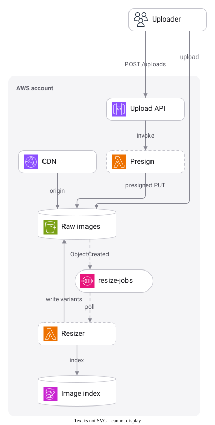</picture></a></td>
<td width="50%" valign="top">Flow<br><br><a href="examples/refund-flow.yaml"><picture><source media="(prefers-color-scheme: dark)" srcset="docs/gallery/refund-flow-dark.drawio.svg">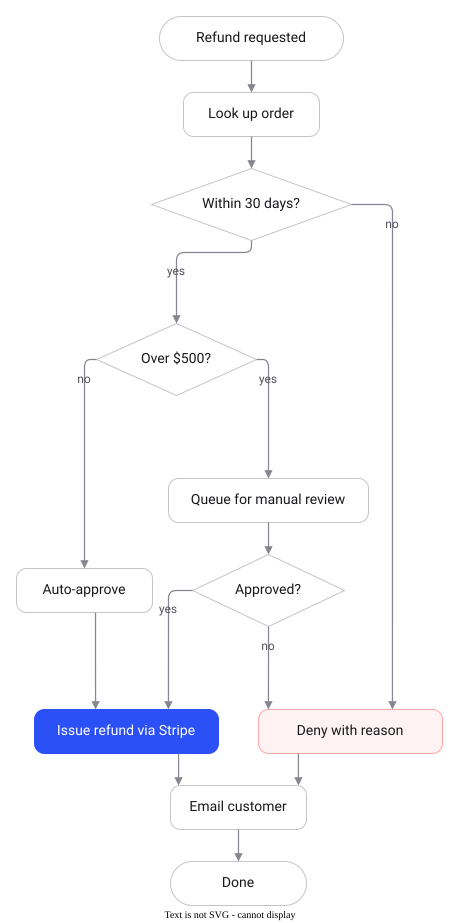</picture></a></td>
</tr>
</table>

State

<a href="examples/job-state.yaml"><picture><source media="(prefers-color-scheme: dark)" srcset="docs/gallery/job-state-dark.drawio.svg">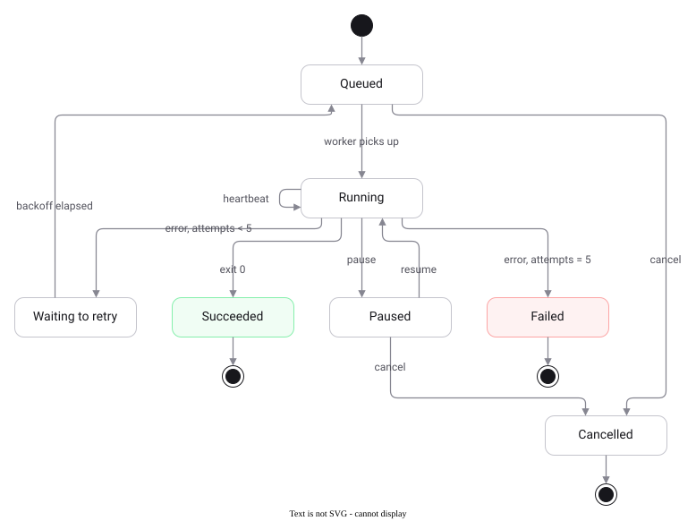</picture></a>

Sequence

<a href="examples/pay-sequence.yaml"><picture><source media="(prefers-color-scheme: dark)" srcset="docs/gallery/pay-sequence-dark.drawio.svg">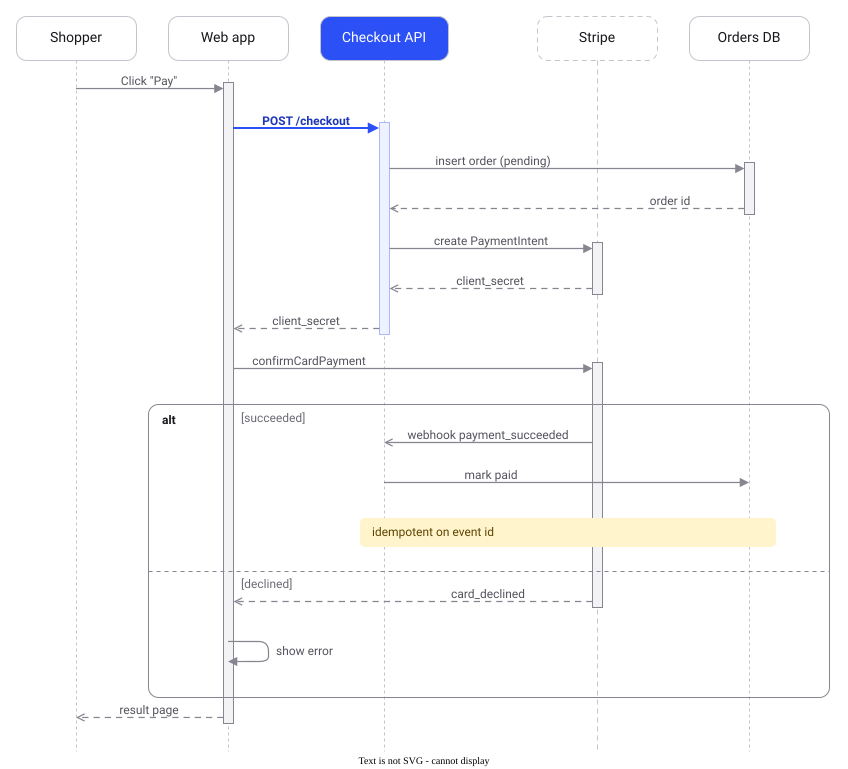</picture></a>

ER

<a href="examples/shop-er.yaml"><picture><source media="(prefers-color-scheme: dark)" srcset="docs/gallery/shop-er-dark.drawio.svg">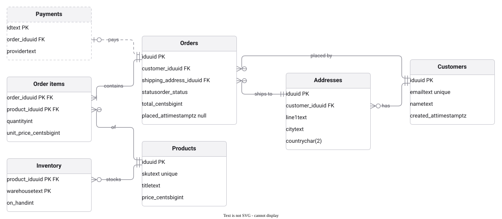</picture></a>

## Styles

Set `theme:` in the spec.

| style | for |
|---|---|
| `clean` (default) | docs and READMEs. White boxes with hairline borders on gray group grounds, IBM Plex Sans. |
| `soft` | slides. Borderless pastel cards, tinted by kind. |
| `dark` | dark-mode pages |
| `sketch` | early drafts. Hand-drawn lines and a handwriting font. |
| `blueprint` | technical deep dives. Blue ink on pale drafting paper, monospace. |
| `c4` | C4-model diagrams, in quiet blues and grays |

The same spec in each style:

<table>
<tr>
<td width="33%" align="center" valign="top"><code>clean</code><br><br>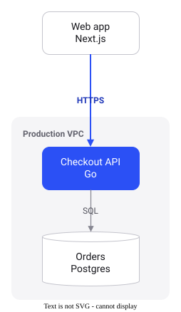</td>
<td width="33%" align="center" valign="top"><code>soft</code><br><br>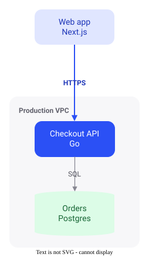</td>
<td width="33%" align="center" valign="top"><code>dark</code><br><br>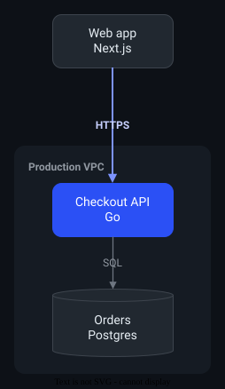</td>
</tr>
<tr>
<td width="33%" align="center" valign="top"><code>sketch</code><br><br>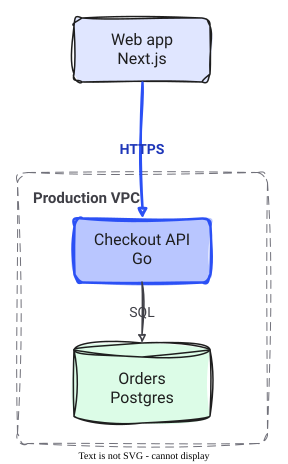</td>
<td width="33%" align="center" valign="top"><code>blueprint</code><br><br>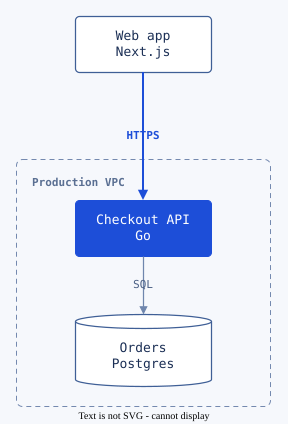</td>
<td width="33%" align="center" valign="top"><code>c4</code><br><br>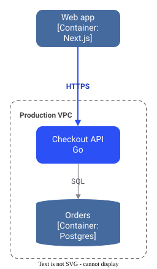</td>
</tr>
</table>

Color is for meaning. Nodes stay neutral by default, and errors and successes are red and green in every style. Mark the part the doc is about with `highlight: true` on a node or `==>` on an edge, and it's drawn in the style's accent color. Use `color: red` (or blue, violet, pink, orange, amber, green, teal, gray) for categories.

Linework sizes every box from the real width of its text in the font it renders with, wrapping long labels instead of widening boxes. Each SVG carries a subset of that font (about 10 to 15KB), so text fits the same way on GitHub, in a browser or in a doc. `check` flags labels that overflow, overlap a box, another label, another edge or a group border, and `build` moves edge labels until they're clear.

Linework needs Node 20+ and a Chromium-based browser, which it uses headless to measure text and render. It tries Playwright's Chromium, then Chrome, then Edge. If none is found, run `linework install-browser`, or set `LINEWORK_CHROME` to a browser binary. If a browser is found but crashes on launch, an agent's sandbox is usually blocking it. Linework then retries Playwright's Chromium in single-process mode, which starts inside Codex's sandbox.

The first drawing command starts a background process that keeps Chromium running, and later commands hand their work to it. A build of the checkout example takes about 1.0s the first time and 0.16s after that. The process listens on a Unix socket in a folder only you can open, exits after 5 idle minutes, and is off on Windows and in CI. `LINEWORK_NO_DAEMON=1` or `--no-daemon` turns it off, and `linework daemon stop` ends it.

Linework keeps the font subsets it embeds in your cache folder (`~/Library/Caches/linework` on macOS, `~/.cache/linework` on Linux, `%LOCALAPPDATA%\linework` on Windows), so rebuilding a diagram doesn't compress the same fonts again. Set `LINEWORK_NO_CACHE=1` to turn that off.

## Connect over MCP

The MCP server is for chat apps and agents that can't run shell commands. Agents with a shell do better with the skill, since they can run the CLI and see its output directly.

| agent | command |
|---|---|
| Claude Code | `claude mcp add linework -- npx -y @itsthecsguy/linework mcp` |
| Codex | `codex mcp add linework -- npx -y @itsthecsguy/linework mcp` |
| Grok Build | `grok mcp add linework -- npx -y @itsthecsguy/linework mcp` |
| GitHub Copilot CLI | `copilot mcp add linework -- npx -y @itsthecsguy/linework mcp` |
| Gemini CLI | `gemini mcp add -s user linework npx -- -y @itsthecsguy/linework mcp` |

Everything else takes the same JSON block in its MCP config file:

```json
{
  "mcpServers": {
    "linework": { "command": "npx", "args": ["-y", "@itsthecsguy/linework", "mcp"] }
  }
}
```

| app | config file |
|---|---|
| Antigravity | `~/.gemini/config/mcp_config.json`, or `.agents/mcp_config.json` in the workspace |
| Cursor | `~/.cursor/mcp.json`, or `.cursor/mcp.json` in the project |
| Claude Desktop | `claude_desktop_config.json` (Settings > Developer > Edit Config) |
| VS Code | `.vscode/mcp.json`, with `"servers"` in place of `"mcpServers"` and `"type": "stdio"` added |

Relative paths in tool calls resolve against the folder the server starts in. Add `"--root", "/path/to/docs"` to the args to pin it. The tools are `build_diagram`, `show_diagram`, `check_diagram`, `render_diagram`, `tidy_diagram`, `import_mermaid`, `list_icons`, `edit_diagram`, `publish_diagram`, and `linework_guide`, which hands the model the spec format and style rules. `build_diagram` returns a PNG preview, so a model that can see images checks its own work.

### Installing the skill by hand

If you'd rather not use the skills installer, copy the skill into your agent's skills folder:

```bash
npx -y @itsthecsguy/linework skill install .agents/skills   # Codex, Cursor, Antigravity, Gemini CLI, Copilot
npx -y @itsthecsguy/linework skill install .claude/skills   # Claude Code
npx -y @itsthecsguy/linework skill install .grok/skills     # Grok Build
```

## Small changes

Once a diagram exists, a change to it keeps everything else where it is. That holds whether a person arranged the layout in draw.io or nobody has touched it.

```bash
linework set docs/checkout.drawio.svg api.label="Checkout API v2" api.highlight=true
linework add docs/checkout.drawio.svg "fraud: { label: Fraud check, in: vpc }" "api -> fraud: score"
linework rm  docs/checkout.drawio.svg cache "api -> stripe"
```

A renamed box grows in place. A new box goes next to the one it connects to, and its group grows to hold it without covering boxes outside the group. A removed box takes its edges with it, and its group closes up. `linework build` with an edited spec follows the same rules. It lays out from scratch only for a new file, a changed direction or theme on a layout nobody arranged, or `--relayout`.

After dragging boxes around in draw.io, `linework tidy <file>` reroutes the edges left behind and moves labels off whatever they landed on. Boxes stay where you put them.

## Editing by hand

Any draw.io editor works on these files: draw.io desktop, VS Code with the Draw.io Integration extension, or app.diagrams.net. Or:

```bash
npx -y @itsthecsguy/linework edit docs/checkout.drawio.svg
```

That opens the bundled draw.io editor in your browser, served from 127.0.0.1. Nothing goes online. Cmd/Ctrl+S writes the file. If an agent rebuilt the file while you had it open, your save goes to a side copy (`checkout.edited-<time>.drawio.svg`) instead of overwriting the agent's work.

## Google Docs

Docs can't hold an SVG, so the diagram lives in Google Drive and draw.io's Google Docs add-on inserts it and refreshes it. `linework publish` copies diagrams into your Drive folder (via Google Drive for desktop) at a fixed path, and `--pull` brings back edits made from the doc. The steps are in [skills/linework/references/google-docs.md](skills/linework/references/google-docs.md).

## Commands

| command | does |
|---|---|
| `linework build <spec\|-> -o out.drawio.svg [--png p.png] [--relayout]` | layout (or merge into an existing file), write, lint |
| `linework set <file> id.field=value...` | change a label, kind, color, theme or title in place |
| `linework add <file> "id: {...}" "a -> b: label"...` | add boxes, groups and edges in place |
| `linework rm <file> id "a -> b"...` | remove boxes, groups and edges in place |
| `linework show <file> [--geometry]` | print the spec of a diagram, including hand edits |
| `linework edit <file> [--no-open]` | edit in the bundled draw.io, in your browser; saves write the file |
| `linework check <file>` | lint: overlaps, edges through nodes, labels that don't fit, too wide |
| `linework render <file> -o out.png [--scale 2]` | preview image |
| `linework tidy <file>` | after hand edits: reroute stale edges and move colliding labels; boxes stay |
| `linework import <file.mmd\|doc.md> [-o out.drawio.svg]` | convert a Mermaid diagram |
| `linework publish <file...> [--to dir] [--pull]` | copy diagrams into Google Drive for the Docs add-on |
| `linework icons <aws\|gcp\|k8s\|azure> [filter]` | list icon names |
| `linework git-setup` | `git diff` shows diagram changes as spec changes |
| `linework skill [install <dir>]` | print or install the agent skill |
| `linework mcp [--root dir]` | MCP server over stdio |
| `linework kinds [type]` | node kinds per diagram type |
| `linework schema` | JSON Schema of the spec |
| `linework daemon [status\|stop]` | the background process that keeps the browser running between builds |
| `linework install-browser` | download the headless Chromium build this version uses |

## Status

All five phases of [PLAN.md](PLAN.md) are built. Two paths haven't been tried yet, because they need a real account or app: the Google Docs add-on round trip, and saving from the VS Code Draw.io Integration extension. Both use the same file format and protocol that the tests cover with draw.io's own editor.

## Development

```bash
npm install
npm test             # unit, round-trip, MCP and end-to-end tests (needs Chromium)
npm run build        # compile to dist/
npm run dev -- build examples/checkout.yaml -o out/checkout.drawio.svg --png out/checkout.png
```

Every push to `main` and every pull request runs the typecheck and the tests on Node 22 and 24 in GitHub Actions. To run the suite with a browser that isn't in one of the usual places, set `LINEWORK_CHROME=/path/to/chromium`.

After a change to layout or rendering, rebuild the README gallery and look at what moved:

```bash
npm run build && node docs/gallery/build.mjs
```

### Releasing

```bash
npm run release            # patch; or: npm run release -- minor | major | 1.2.3
```

That bumps the version, commits it as `Release x.y.z`, tags `vx.y.z` and pushes both. The tag starts the release workflow, which runs the tests again, publishes to npm and opens a GitHub release with generated notes. Nobody logs in to npm: the workflow publishes through npm's [trusted publishing](https://docs.npmjs.com/trusted-publishers), which is set up once in the package's settings on npmjs.com (GitHub Actions, repository `itsthecsguy/linework`, workflow `release.yml`).

`assets/drawio` holds the parts of the draw.io web app that linework runs: the renderer it uses headless, and the editor behind `linework edit`. draw.io is Apache-2.0; see [NOTICE](NOTICE). To update it, check out a jgraph/drawio tag in `vendor/drawio` and run `npm run assets`.
